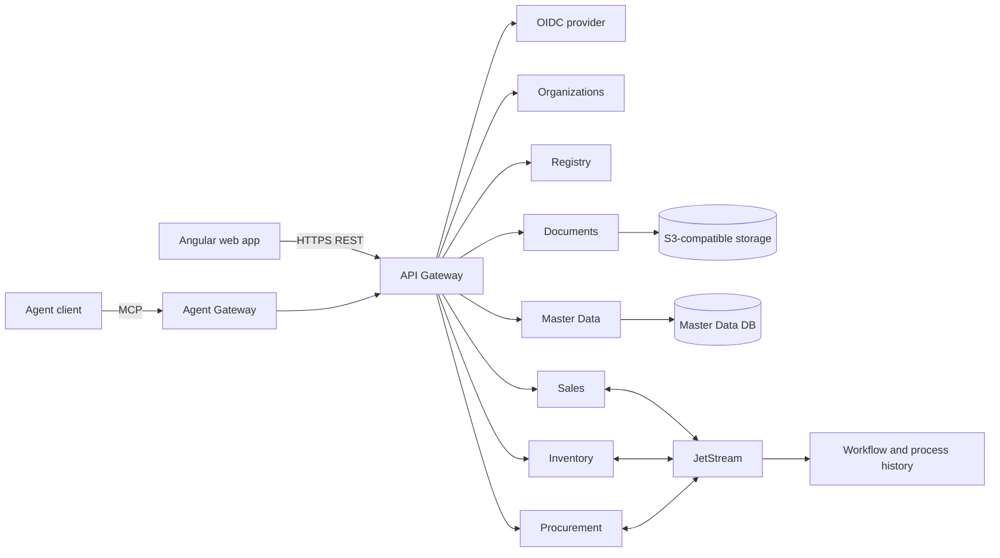

# Architecture baseline

This diagram is the MVP target, not a deployment diagram. The bootstrap includes only Master Data and its MongoDB database. Each service persists state in its own MongoDB database with its own credentials, indexes, validations and migration history. A physical replica set may be shared. No cross-service writes, queries against another service's collections, or shared business-domain crates. Use REST for clients, Core NATS where internal request/reply is useful, and JetStream for durable async communication. Organizational references travel as opaque IDs or explicit historical snapshots; do not model cross-database joins as a required runtime dependency.

| Boundary | Ownership and integration |
|---|---|
| Gateway | Routing, ingress policy and request context. No business rules, direct DB access, or transparent override of service authorization. OIDC is delegated to an established IdP. |
| Organizations | Tenants, legal entities, organizational hierarchy, sites, identity bindings and memberships. Tenant is the top isolation boundary; organization grants narrow it. A warehouse is an Inventory aggregate optionally linked to a site. |
| Registry | Service identity and activation, manifests, semantic schemas, capability discovery and module compatibility. The deployment controller is separate from the web app. |
| Documents | Versioned metadata and business references in MongoDB; binaries in private S3 storage. Owns pending/finalized uploads, checksum and content checks, signed URLs and recovery of abandoned uploads. |
| Workflow | Persistent state and timers for the first order-to-procurement saga. Record transitions and compensations; not a generic BPMN engine. |
| Audit, Search, Notifications | Independent capabilities and potentially separate deployments; initially use the saga history for the MVP timeline. Future projections are authorized and rebuildable where appropriate, never business systems of record. |
| Agent Gateway | Discover approved MCP tools, enforce actor context, budgets and approval, dispatch via the same business APIs as users. Not a data store for domain records. |
| Master Data | Partners (customer and supplier roles), addresses, articles and UoM definitions. Partner extraction is possible later without shared ownership. |
| Sales | Quotations, conversion, order lines, confirmation and status. Retains agreed customer/item/price snapshots and publishes order events. |
| Inventory | Warehouses, immutable stock ledger with reversal commands, availability and reservations. Owns shortage decisions and receipt posting. |
| Procurement | Requests, proposals, approval, supplier choice and purchase orders. Receipt status is derived from Inventory events. |
| Future domains | CRM (relationship activity/opportunities), Finance (journal and subledgers), Manufacturing/MES (execution), Production Planning (plans), Projects, Service and Maintenance, HR, Quality, Assets and Analytics. Each gets a boundary proposal when its invariants are known. |

## Data and reliability

- Resolve a user, service or agent identity and verified membership at ingress; enforce scope again in owning services. Include tenant and organization in persistence selectors, uniqueness constraints, audit context and relevant messages. Never infer access from an ID or a supplied tenant header. Consider physical isolation as a separate deployment requirement.
- Use UUIDs, schema versions, monotonic revisions, UTC RFC 3339 timestamps for instants, and actor attribution. Updates check expected revision where there is concurrent editing. Version migrations, test upgrade/restore and use expand/contract; DB validation supplements service invariants. Tags, custom fields and relationships need explicit schemas and permission checks.
- Prefer exact decimal strings on the wire and typed decimal arithmetic. Pair money with explicit ISO 4217 currency and quantities with a UoM. Define scale/rounding per operation, rate source and effective time, and persist the applied rates and historical snapshots. Business dates are distinct from UTC instants and evaluated in the appropriate IANA time zone. Business document sequences are not entity IDs and must be uniquely allocated within a documented scope.
- Use MongoDB replica sets when transactions are required. Commit business writes and outbox records atomically. A relay sends a stable message ID and waits for the broker acknowledgement; consumers persist a deduplication marker and effect in one transaction before acking. Handle duplicate, stale and out-of-order inputs using aggregate revisions or explicit saga transitions; use bounded retries, observable quarantine and authorized repair/replay. Do not assume exactly-once execution. Never use distributed database transactions.
- TLS, least privilege and per-service credentials are production requirements. Add OpenTelemetry context across HTTP and NATS, with redaction, bounded timeouts and graceful drain. Backup/restore requires coordinated recovery of DBs, object metadata and saga/broker state; test procedures before production use.

## Frontend, extensions and operations

Angular is a separately deployed HTTP client. Use Signals and strict TypeScript for state, CDK for accessible interactions, Reactive Forms for validated input, Tailwind/Lucide for the design system and ECharts only where useful. Start with metadata-driven article registration and detail, localization keys (English/German), and no executable code from manifests. Add navigation, tables, filters, saved views, command palette, workspace and approval UI incrementally. Trusted custom components are installed through the frontend build, not loaded from unsigned metadata.

Compose is the local/small-install path; use Helm when probes, migrations, secrets and upgrade responsibilities have explicit contracts. Add only required infrastructure: MongoDB, NATS, an S3-compatible implementation and an OIDC provider. Build versioned OCI images and add scanning, SBOMs, provenance/signing and amd64/arm64 validation before publishing to GHCR. WASI/Wasmtime and the Component Model are evaluation candidates for isolated plugins with resource and capability limits, not MVP dependencies. Evaluate BPMN and established engines only when the first saga no longer suffices.
