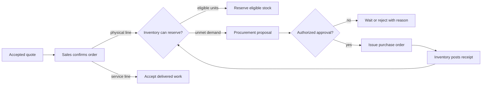

# Process investigation catalog

[Process cards](catalog.yaml) describe possible paths, not executable workflows. Each card records trigger, participants, preconditions, main path, variants/failure, approval, result event and requirement links. The objects named in the flow are owned by the corresponding capability; event names are analytical vocabulary until published in a contract. Configure approval thresholds, partial delivery, outsourcing and sequence within the owning policies. Tenant checks, conservation, historical snapshots and no duplicate financial/stock effect are invariants, not optional workflow steps.

In the approved SC-05 reference flow both branches apply: reserve the six eligible units now and leave four open. Ship-complete terms prevent dispatch of the six alone; they do not prevent holding the six. Procurement requires separate approval. A service-only engagement never enters the inventory branch.

**Reading a card:** `objects` names the records, `result` gives the measurable business outcome, and `outcomeEvent` names what another participant may observe. `alternative` describes a legitimate variant; `exception` describes a failure or blocked path. For example, *Purchase requisition to purchase order* starts with unmet demand, creates a proposal, then an authorized PO; rejection produces no supplier commitment. These are logical processes: no requirement to run a workflow engine before any given step.
