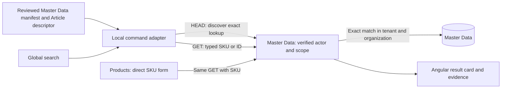

# Global command interface

**Status:** Local, read-only Article prototype for [#85](https://github.com/erp4us-org/erp4us/issues/85). No generic search API, provider, action execution, runtime registry or MCP adapter is enabled.

## Interaction

An operator who already knows a product code should not need to know which service owns it. Enter an exact SKU, a canonical Article UUID, or a supported prefix and one SKU. For example, enter `Find article with SKU BRACKET-1` or `Zeige mir den Artikel mit SKU BRACKET-1`. The UI normalizes ASCII SKU casing, whitespace and an optional trailing question mark. It asks for one identifier if a known query is incomplete or ambiguous. It does not infer name searches, stock, orders, or a revision from a product code. There is no conversational context in this prototype.

The compact desktop header remains available on scroll. The input and native submit button occupy a separate row at narrow widths to preserve reading and touch targets. Ctrl+K and Cmd+K focus search; tab to the permitted suggestion or result link; Escape clears the search and returns focus to the input. The result leads with the matching article and exposes the interpreted operation, filter, selected demo scope, source and record revision. The preview does not claim source freshness from a record revision. The same result can be reached through **Products → Find article by SKU**, without natural language or AI. Opening the article rechecks the current owner-side read permission.

## Authority and extension

- The build-time binding uses the existing `master-data.article` capability, `getArticle` and `findArticleBySku` operations, and `master-data.article.read` permission in the [semantic descriptor](../../contracts/entities/article-v1.json). Localized phrases are data, not scripts or routing instructions.
- The UI checks `discoverArticleSkuLookup` when entering the search surface with a credential. It suggests the read only after the owner returns `204`. This is a presentation hint for that interaction, not a grant or health state. Unknown metadata, an unavailable endpoint or a denied check produces no suggestion. Every query is a fresh request using the existing bearer, tenant and organization headers and independently enforced by Master Data.
- There is no persisted search history, no free-form database expression, generated subject, or external request. Ingress configurations should redact Authorization and omit lookup query strings from access logs. Clearing or replacing the credential aborts outstanding reads and invalidates discovery and results. Editing the input or leaving the interaction also cancels its pending reads. Organization switching is not enabled; any future switch must verify membership server-side, honour pending edits and reset the read context before activating the new scope.
- To extend search after review, register a typed adapter to an existing operation ID and published owner contract; validate its metadata, bound its inputs and response, and pair a renderer with that typed result. Untrusted text is rendered as text. Do not execute resource URLs, scripts, HTML, CSS or command text from a descriptor or result. With multiple plausible operations or entities, clarify rather than choose silently.
- A future provider may propose an allowlisted operation and typed arguments, but cannot execute it or see unapproved data. A future MCP adapter uses the same semantic IDs, typed schemas and owner-side permissions. A separate governed action flow is required for writes. The read prototype does not offer or call one.

## Structured results

`CommandResult` is a versioned **client view model**, not a new wire response or a shared business model. Version `1` contains the selected OpenAPI operation with its exact typed filter, plus either one validated Article or an error status. Article fields continue to use the existing Article wire schema. Clarification and unsupported input are resolved before dispatch. No Matches means the owner answered `404` in scope; an absent credential or `401`/`403` is Unauthorized and exposes no result or interpreted capability. Service Unavailable is distinct from Execution Error (unexpected response or mismatched identifier).

For a second domain result, review a language-neutral envelope before publishing it: summary key and typed arguments, interpretation, authorized scope, applied filters, source references and revisions, freshness and evidence, versioned renderer discriminator, related entities and independently permitted actions. Partial Evidence or Stale Evidence must preserve **unknown**, never encode it as zero, available or approved. Render only registered component types. Provide accessible text alternatives to trees/charts, and do not add a generic visualization contract until a real source supplies the necessary facts. [#126](https://github.com/erp4us-org/erp4us/issues/126) is the intended second test of this boundary, not a shipped capability.
