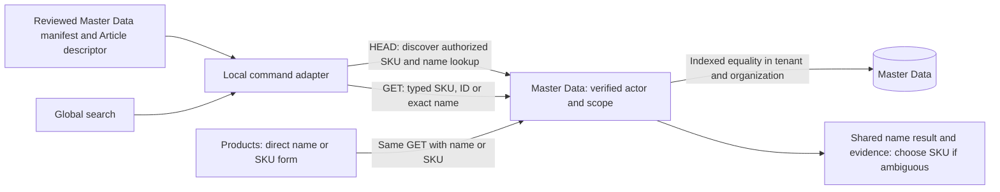

# Global command interface

**Status:** Local, read-only Article prototype for [#85](https://github.com/erp4us-org/erp4us/issues/85). No generic search API, provider, action execution, runtime registry or MCP adapter is enabled.

## Interaction

An operator who already knows a product code or exact Article name should not need to know which service owns it. Enter a SKU, a canonical Article UUID, or a supported prefix and one value. For example, enter `Find article with SKU BRACKET-1` or `Zeige mir den Artikel mit SKU BRACKET-1`. The UI normalizes ASCII SKU casing and surrounding whitespace and accepts an optional trailing question mark for SKU/ID input. For a name, explicitly ask `Find article named "Steel bracket"` or `Finde Artikel mit Bezeichnung "Stahlwinkel"`. Exact names preserve case, internal whitespace, punctuation and Unicode representation; use quotes to preserve leading or trailing whitespace. The prototype does not guess name intent from bare text, silently change matching rules, or infer stock, orders or a revision.

The compact desktop header remains available on scroll. The input and native submit button occupy a separate row at narrow widths to preserve reading and touch targets. Ctrl+K and Cmd+K focus search; tab to a permitted suggestion or result link; Escape clears the search and returns focus to the input. In **Products → Find article by exact name**, enter the stored name directly, without an intent phrase or quotes for whitespace. Both name entry points use the same lookup adapter and result component. If several authorized articles share the name, choose by SKU. The result shows at most the first five records in ascending SKU order; it never selects one automatically. A truncation notice directs the user to an exact SKU rather than implying the list is complete. The result exposes the interpreted operation, filter, selected demo scope, source and, for a single article, its revision. The preview does not claim source freshness from a record revision. Products also supports exact SKU and ID lookup without AI. Opening any Article rechecks its current owner-side read permission.

### One bounded follow-up

After a successful global exact-name lookup, type `Only SKU BRACKET-1` or `Nur SKU BRACKET-1` with a SKU displayed in the answer. The original name remains visible while narrowing. This alternative to choosing a result link can only refer to the displayed candidates, even when more results exist. An unshown SKU cannot trigger a follow-up read; use a separate standalone SKU lookup instead. The Products form and its SKU choice still work without a command.

The client keeps at most the displayed Article IDs, SKUs and revisions with the exact name, a two-minute expiry and the in-memory credential version. This is bound to the fixed demo scope, not a browser assertion of verified identity or additional authority. The follow-up issues a fresh owner-authorized `findArticleBySku` request and checks that the returned ID and name still match and the revision is not older. Changed evidence is not rendered as a valid continuation. Missing context, rejected access, unknown results and an unavailable service remain distinct.

The context is not persisted or sent to the server. Clear it with **Clear search context** or Escape. Leaving the search interaction, navigating, replacing the credential, starting a new standalone lookup or reaching expiry discards it. No generalized conversation, cross-service follow-up, write or saved query is enabled.

## Authority and extension

- The build-time binding uses the existing `master-data.article` capability, `getArticle`, `findArticleBySku` and `findArticlesByName` operations, and `master-data.article.read` permission in the [semantic descriptor](../../contracts/entities/article-v1.json). Localized phrases are data, not scripts or routing instructions.
- The UI checks `discoverArticleSkuLookup` and `discoverArticleNameLookup` when entering the search surface with a credential. It suggests each read only after the owner returns `204`. This is a presentation hint for that interaction, not a grant or health state. Unknown metadata, an unavailable endpoint or a denied check produces no suggestion for it. Every query is a fresh request using the existing bearer, tenant and organization headers and independently enforced by Master Data.
- There is no persisted search history, no free-form database expression, generated subject, or external request. Ingress configurations should redact Authorization and omit lookup query strings from access logs. Clearing or replacing the credential aborts outstanding reads and invalidates discovery and results. Editing the input or leaving the interaction also cancels its pending reads. Organization switching is not enabled; any future switch must verify membership server-side, honour pending edits and reset the read context before activating the new scope.
- To extend search after review, register a typed adapter to an existing operation ID and published owner contract; validate its metadata, bound its inputs and response, and pair a renderer with that typed result. Untrusted text is rendered as text. Do not execute resource URLs, scripts, HTML, CSS or command text from a descriptor or result. With multiple plausible operations or entities, clarify rather than choose silently.
- A future provider may propose an allowlisted operation and typed arguments, but cannot execute it or see unapproved data. A future MCP adapter uses the same semantic IDs, typed schemas and owner-side permissions. A separate governed action flow is required for writes. The read prototype does not offer or call one.

## Structured results

`ArticleLookupResult` is a versioned **client view model**, not a wire response or a shared business model. Version `1` contains the selected OpenAPI operation with its exact typed filter, plus one validated Article, a bounded set of candidates for explicit disambiguation, or an error status. ID and SKU reads continue using the existing Article wire schema. The [name result](../../contracts/schemas/article-name-matches-v1.json) only exposes Article ID, SKU, name and revision for each candidate plus a `hasMore` indicator; it never exposes totals or creator/organization fields. Invalid input is resolved before dispatch. No Matches means the owner answered `404` for ID/SKU or returned an empty list for name. An absent credential or `401`/`403` is Unauthorized and exposes no result or interpreted capability. Service Unavailable is distinct from Execution Error (unexpected response, malformed candidates or mismatched filter). The Products name form cancels pending requests when edited or left, and results from a previous credential version cannot render.

Master Data creates the additive `(tenant_id, organization_id, name, sku)` index at startup. The query uses binary collation, a scoped equality predicate and an index-backed read of at most six rows; the sixth establishes `hasMore` without a count. It does not re-key stored names or require new grants. On larger existing data sets, plan for the index build before claiming readiness. Rolling back the application leaves the index harmlessly present; no data rewrite or index deletion is needed for rollback.

For a second domain result, review a language-neutral envelope before publishing it: summary key and typed arguments, interpretation, authorized scope, applied filters, source references and revisions, freshness and evidence, versioned renderer discriminator, related entities and independently permitted actions. Partial Evidence or Stale Evidence must preserve **unknown**, never encode it as zero, available or approved. Render only registered component types. Provide accessible text alternatives to trees/charts, and do not add a generic visualization contract until a real source supplies the necessary facts. [#126](https://github.com/erp4us-org/erp4us/issues/126) is the intended second test of this boundary, not a shipped capability.
