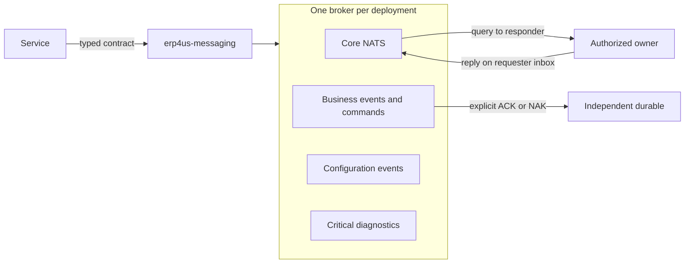
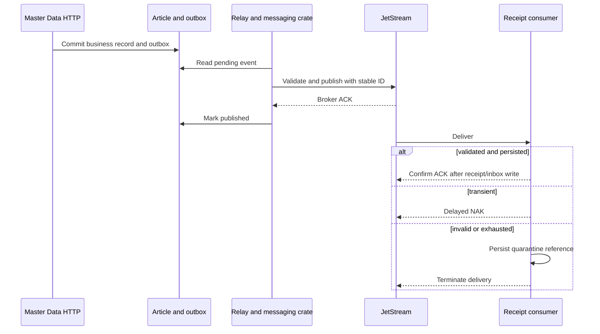
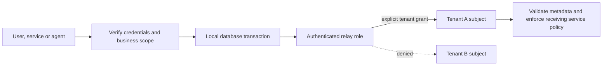

# erp4us NATS messaging protocol

## Subjects and versioning

`v<protocol-major>.<layer>.<scope>.<domain>.<kind>.<resource>.<action>.v<schema-major>` is mandatory on application topics. Broker system subjects, JetStream API subjects and native reply inboxes are exempt. Majors are positive canonical base-ten integers (no leading zeroes; at most `u64`). Domain, resource and action use `[a-z][a-z0-9-]{0,62}`. Scope is `system` or a nonzero canonical lowercase hyphenated UUID assigned by the platform. No paths, PII, secrets, or wildcards in published subjects. Organization belongs in the envelope, not the subject. Events are facts, commands request actions and queries never mutate business state.

`v1.business.<tenant-uuid>.master-data.event.article.registered.v1` and suffix `v2` can coexist without changing the protocol. Prefix `v2` is a separate protocol generation. `Route::all_scopes` only wildcards scope; use it only with a grant spanning the intended scopes. Any subscription across majors must dispatch to explicit implementations or reject the message. Deploy separate stream/consumer definitions and grants for new majors, and migrate readers before retiring writers. A breaking metadata or semantics change requires a new protocol major; a breaking payload or behavior change requires a new schema major. Minor changes are additive and optional to existing readers; patches correct a compatible contract. Every consumer advertises tested bounds, not implicit major-only support; the initial Article consumer accepts exactly `1.0.0` for both axes. Producers only send their declared schema version. Test rolling upgrades, retain old fixtures, publish a deprecation deadline and coordinate drain, archival and grant removal. Do not silently convert stored broker messages during replay.

## Envelope and headers

The [JSON envelope](../../contracts/schemas/nats-envelope-v1.json) is the source of wire metadata. `messageType` is the full subject, `timestamp` is RFC 3339, and `actor` is `{id, kind}` (`user`, `service`, or `agent`), required for tenant messages. Payload is a contract-specific JSON object. A new root starts a correlation with its message UUID; a derived message has a fresh UUID, propagates the same correlation ID and records the triggering ID as causation. Replay retains the original identities. The [Article fixture](../../contracts/examples/nats/article-registered-v1.json) is consumed by both Rust and JSON Schema contract tests.

| Header (case-insensitive name) | Representation and rule |
| --- | --- |
| `Erp4us-Protocol-Version`, `Erp4us-Schema-Version` | Required release SemVer `X.Y.Z`; canonical, no prerelease/build, equals envelope and subject major; must be in range. |
| `Erp4us-Service-Version` | Required canonical SemVer; equals envelope; informative, does not imply wire compatibility. |
| `Erp4us-Message-Id`, `Erp4us-Correlation-Id` | Required nonzero UUID, lowercase hyphenated; equal envelope. |
| `Erp4us-Causation-Id` | Same UUID form; present exactly when envelope has causation ID. |
| `Erp4us-Source` | Required dotted service identifier (same token rules, total max 127), equals envelope. Not proof of identity. |
| `Erp4us-Tenant-Id` | Required for tenants, forbidden for `system`; same UUID form and value as scope and envelope. |
| `Erp4us-Organization-Id` | Same UUID form; required for organization-scoped contracts, forbidden for system messages; equals envelope. |
| `Content-Type` | Required literal `application/json`; no media type parameters in v1. |
| `traceparent` | Optional W3C v00, lowercase hex and nonzero trace/span IDs; matches envelope. |
| `tracestate` | Optional W3C trace state, only with `traceparent`; identical to envelope, max 512 bytes and 32 entries, no repeated keys. |
| `Nats-Msg-Id` | Required for JetStream sends: message UUID normally, `replay-<positive-original-stream-sequence>-<uuid>` for operator replay. Deduplication only, never authorization. |

Reject missing required fields, multiple values of a known header, inconsistencies and unsupported versions before business handling. Consumers quarantine permanent invalid durable messages before terminating delivery; never copy sensitive bodies to logs. Unknown additive fields are allowed but never authorize behavior. JSON Schema validates shape, not cross-field equality or broker authorization. Trace metadata is for propagation; no exporter or instrumentation backend is required.

## Delivery and error handling

| Layer | Core | JetStream |
| --- | --- | --- |
| `business` | Read-only queries | Domain events and async commands, separate streams |
| `config` | Scoped settings reads, explicit authorized update requests where a contract defines them | Change notifications |
| `diagnostics` | Heartbeats and ephemeral status | Explicit `critical` event actions only |

Transport and the stream are part of the contract; Core publication is not a delivery acknowledgement. Core query replies go only to the native inbox and use JSON `{"result": ...}` or `{"error":{"code":"forbidden","retryable":false,"correlationId":"<uuid>"}}`, exactly one member; define stable codes and result shapes per query (e.g. `invalid_request`, `forbidden`, `not_found`, `unavailable`). No-responder and timeout are transport outcomes, not body errors. The initial crate returns the native reply for contract-specific validation. Never retry mutation requests blindly.

JetStream is at least once, not exactly once. Ack after the local effect and inbox commit; keep the inbox across replay. Retry network or database outages with bounded work, backoff and (for general competing workers) jitter. Treat invalid encoding, scope, versions and denied permissions as permanent until corrected. Broker timeouts and store exhaustion must never mark an outbox row published. The single local Article relay polls with a fixed delay; the consumer attempts receipt persistence up to four deliveries and keeps retrying quarantine persistence if unavailable. Local logs remain available when NATS is unavailable.

## Configuration and diagnostics

Deployment values live in deployment infrastructure; secrets stay in secret stores and are never sent in `config`. Runtime queries must name the settings owner and scope; `system` is only for explicitly authorized platform/service configuration. Organization settings use tenant scope plus organization ID, which the owner authorizes independently. For a new setting contract, define input validation, version, effective scope, stable revision, compare-and-set update semantics and authorization/audit rules. Notifications carry a revision and safe identifiers, never secrets; the owner commits configuration, audit and outbox together. On startup or revision gaps, fetch an authorized snapshot, apply only newer revisions, and tolerate duplicates. NATS KV may suit ephemeral technical watches/caches; it is not the authoritative ERP configuration store.

The local Article Relay owns one [system configuration contract](../../contracts/schemas/nats-relay-heartbeat-config-v1.json). A Core query on `v1.config.system.article-delivery.query.heartbeat.get.v1` returns `{revision, heartbeatSeconds}` under `result`. A JetStream event on `v1.config.system.article-delivery.event.heartbeat.changed.v1` carries just the revision; authorized readers obtain the value via the query. Request and event use exact `1.0.0` protocol/schema versions. Malformed queries are dropped and logged; valid queries return `unavailable` if persistence fails. A consumer that caches this setting should reconcile periodically even when no event arrives. This is technical system configuration, not a source of tenant or organization policy.

Diagnostic contracts identify the service, instance, versions, timestamp and uptime. Report health/readiness and relevant dependency states only when measured; health vocabulary is `starting`, `healthy`, `degraded`, `unhealthy`, `stopping`. Optional signals include backlog and sanitized diagnostic codes. The [relay heartbeat](../../contracts/schemas/nats-relay-heartbeat-v1.json) reports presence and NATS connection only, not readiness or a database check. Default interval is 15 seconds (`ERP4US_HEARTBEAT_SECONDS`, `0` disables); monitor by service and instance, flag absence after three configured intervals from local receipt time, and allow for initial grace. Existing HTTP liveness/readiness do not depend on this signal. No business data, secrets or payload dumps in diagnostics.

## Trust

TLS and broker authentication prove the connection's operational principal, not the actor in the JSON. Broker ACLs constrain publication, subscription and JetStream API access; they do not validate authorization of tenant, organization or actor. Use exact per-tenant grants or segregated accounts and audited imports/exports where stronger isolation is required. Multi-tenant principals are trusted only for explicitly enumerated scopes; split credentials by purpose, verify delegation and use narrow inbox grants (prefer dedicated inbox prefixes or bounded response permissions). Never bridge an external integration, UI or agent straight onto the internal broker. HTTP/gateway identities and service-side policy must authorize each business operation regardless of human or automated origin. Manifest declarations never provision permissions.

