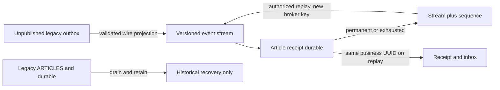

# Local NATS operations

The optional Compose overlay runs one pinned broker with local password identities, a private network and persistent file storage. Compose does not expose NATS to the host. The provisioner waits for a container-local JetStream health check, declares the streams and durable in `article-delivery init`, creates missing resources, and refuses drift in the subject, core retention and explicit-ack policy. Limits retention permits independent consumers per application. The business event, business command, config event and critical diagnostic streams expire at 30, 7, 14 and 2 days, with byte caps and discard-new behavior. Heartbeats and queries are outside all stream filters. There is no production deployment here.

For production, use a TLS `NATS_URL` with the broker's verified server name and mount `NATS_CREDENTIALS_FILE` (NATS JWT/NKey credentials) from a secret store. That setting requires TLS; set `NATS_CA_FILE` to add a private root CA. Provision data and grants with a separate operator identity, scoped accounts or dedicated tenant allowlists, isolated deployment environments, protected volumes, capacity alerts, backups and rehearsed restore. Treat `article_replay` as a privileged operator: stream raw retrieval includes the entire stream, not just an application subject. Isolate tenant data/accounts or mediate raw replay before enabling multi-tenant production. The demo receipt durable filters the single demo tenant; widen neither the credentials nor the filter as a substitute for authorization. Broker image advisory review is tracked separately.

## Revisioned relay heartbeat (local reference)

With the delivery overlay running, query the current system setting and change it with an explicit expected revision:

```sh
docker compose -f compose.yaml -f compose.delivery.yaml run --rm --no-deps article-config-reader
docker compose -f compose.yaml -f compose.delivery.yaml run --rm --no-deps article-relay set-heartbeat 0 30
```

Use the returned `revision` instead of `0` if the journal already contains a change. A stale update fails; reread the setting before deciding whether to retry. Revision zero uses `ERP4US_HEARTBEAT_SECONDS` (default 15). The first successful update writes revision one, and subsequent revisions take precedence over the environment. Use `0` seconds to disable heartbeats, or an integer from `1` to `3600` to enable them. This does not stop Article delivery.

The operator write needs MongoDB, not NATS. The journal commits the setting and its notification together; after reconnection, the relay publishes pending notifications and records the JetStream ACK. If the ACK was not recorded and the broker's duplicate window has expired, the same event can be delivered again. Change events carry only the revision. Readers should query on startup and reconcile via the authoritative snapshot on reconnect, on a newer notification, or periodically if notifications may be missed. Never replace a newer snapshot with an older revision.

The reader principal can query only this system setting and observe its live change subject; it cannot write or administer JetStream. The local operator uses Compose access and the demo relay's MongoDB credential. Neither mechanism authorizes tenant configuration or provides a production operator interface. Keep the journal with the existing MongoDB backups; older relays ignore it and use their environment when rolled back.

To exercise this behavior, use an isolated Compose project and fresh synthetic volumes. Start the overlay with `ERP4US_HEARTBEAT_SECONDS=2` and run `python3 tests/integration/config.py` with the same project selected. The test temporarily stops its broker and simulates an unrecorded ACK; never run it against a shared or production stack.

## Cutover from `ARTICLES`

1. Save the prior release images/Compose configuration and back up MongoDB plus JetStream consistently. Stop the old relay and quiesce registrations/operators; leave the old receipt consumer running until its `ARTICLES/article-receipts` durable has no unacknowledged or pending deliveries. Verify any quarantined entries and finish time-sensitive historical replays with the old tools. Stop the old receipt consumer and prevent legacy writers from restarting. Do not run old and new relay roles at the same time.
2. Start the new overlay with the original volumes and credentials. Bootstrap fails closed when a nonempty `ARTICLES` stream has an uninspectable or undrained durable. It creates new resources without changing `ARTICLES`. Inspect nonzero rejected-outbox counts and durable status before resuming traffic.
3. Upgrade Master Data and the relay together before resuming writes. New Article outbox entries store the complete v1 envelope. The relay projects pending legacy rows to v1 at publication, preserving the IDs, creation time, scope, actor and trace. It does not rewrite historical envelopes, resend entries already marked published, backfill existing business records, or remove old broker data. Records with invalid local metadata remain in MongoDB with `deliveryRejectedAt`; investigate before removing that marker. The receipt inbox is still keyed by the original UUID. New quarantines use `ERP4US_BUSINESS_EVENTS_V1:<sequence>`; legacy keys remain unchanged.
4. Replay a retry-exhausted entry from the new stream using `article-replay replay <numeric-sequence>` before retention expires. There is no implicit legacy broker conversion. For retained legacy messages, restore the old binaries, credentials and consistent data in an isolated recovery stack; inspect and reconcile per message UUID before transferring any effects. Never change old bytes or reuse raw stream sequence numbers across streams. Do not run overlapping operator replays.
5. To roll back, quiesce new publishers and drain the new outbox and receipts. Reconcile published UUIDs and quarantines against the new broker before restoring old grants, the old Master Data writer and the old relay. The old relay cannot read pending v1 outbox records; if they cannot be drained, keep the new relay available for recovery rather than switching blindly. Do not unset `publishedAt` or discard either stream. Restore tests must retain receipt/inbox state together with the broker, or repeated business effects may result.


