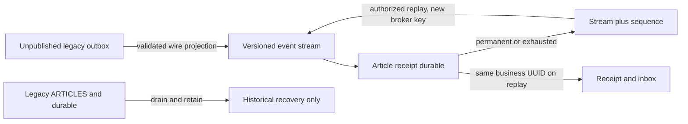

# Local NATS operations

The optional Compose overlay runs one pinned broker with local password identities, a private network and persistent file storage. Compose does not expose NATS to the host. The provisioner (not a service identity) declares the streams and durable in `article-delivery init`, creates missing resources, and refuses drift in the subject, core retention and explicit-ack policy. Limits retention permits independent consumers per application. The business event, business command, config event and critical diagnostic streams expire at 30, 7, 14 and 2 days, with byte caps and discard-new behavior. Heartbeats and queries are outside all stream filters. There is no production deployment here.

For production, use TLS with trusted CA/server-name verification and credentials from a secret store; `ConnectOptions` supports TLS, CA roots, NKeys and credentials files. Provision data and grants with a separate operator identity, scoped accounts or dedicated tenant allowlists, isolated deployment environments, protected volumes, capacity alerts, backups and rehearsed restore. Treat `article_replay` as a privileged operator: stream raw retrieval includes the entire stream, not just an application subject. Isolate tenant data/accounts or mediate raw replay before enabling multi-tenant production. The demo receipt durable filters the single demo tenant; widen neither the credentials nor the filter as a substitute for authorization. Broker image advisory review is tracked separately.

## Cutover from `ARTICLES`

1. Save the prior release images/Compose configuration and back up MongoDB plus JetStream consistently. Stop the old relay and quiesce registrations/operators; leave the old receipt consumer running until its `ARTICLES/article-receipts` durable has no unacknowledged or pending deliveries. Verify any quarantined entries and finish time-sensitive historical replays with the old tools. Stop the old receipt consumer and prevent legacy writers from restarting. Do not run old and new relay roles at the same time.
2. Start the new overlay with the original volumes and credentials. Bootstrap fails closed when a nonempty `ARTICLES` stream has an uninspectable or undrained durable. It creates new resources without changing `ARTICLES`. Inspect nonzero rejected-outbox counts and durable status before resuming traffic.
3. The relay maps pending local Article outbox envelopes to the v1 wire format at publication, preserving the IDs, creation time, scope, actor and trace. It does not rewrite historical envelopes, resend entries already marked published, backfill existing business records, or remove old broker data. Records with invalid local metadata remain in MongoDB with `deliveryRejectedAt`; investigate before removing that marker. The receipt inbox is still keyed by the original UUID. New quarantines use `ERP4US_BUSINESS_EVENTS_V1:<sequence>`; legacy keys remain unchanged.
4. Replay a retry-exhausted entry from the new stream using `article-replay replay <numeric-sequence>` before retention expires. There is no implicit legacy broker conversion. For retained legacy messages, restore the old binaries, credentials and consistent data in an isolated recovery stack; inspect and reconcile per message UUID before transferring any effects. Never change old bytes or reuse raw stream sequence numbers across streams. Do not run overlapping operator replays.
5. To roll back, quiesce new publishers, drain new receipts, and reconcile published UUIDs and quarantines against the new broker before restoring old grants and workers. Do not blindly unset `publishedAt` or discard either stream. Restore tests must retain receipt/inbox state together with the broker, or repeated business effects may result.

